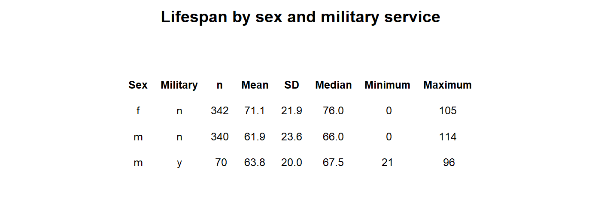
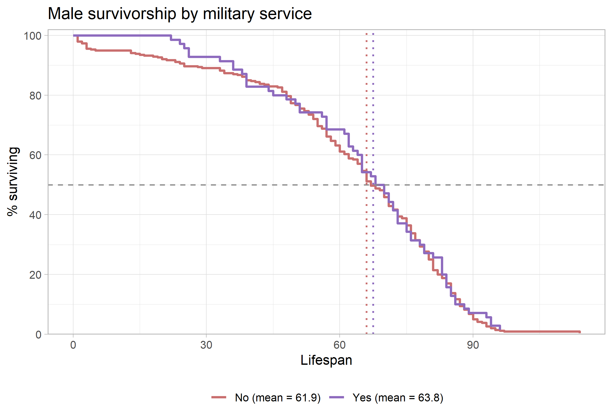

```{=latex}
\onecolumn
\begingroup
\thispagestyle{empty}
\sffamily

% Publication line and journal masthead
\noindent
\begin{minipage}[t]{0.66\linewidth}
  \scriptsize
  Hendrickson. \textit{Survivorship Curves of Sunset Hill Cemetery}
  \hfill (2026) 1:1\\
  Valdosta State University, Ecology and Evolution
\end{minipage}
\hfill
\begin{minipage}[t]{0.30\linewidth}
  \raggedleft
  \large Cemetery Demography\\[-2pt]
  \large BIOL 3250
\end{minipage}

\vspace{0.28in}

% Article-type band
\noindent
\colorbox{reportred}{%
  \parbox{\dimexpr\linewidth-2\fboxsep\relax}{%
    \color{white}
    \textbf{RESEARCH ARTICLE}\hfill
    \textbf{CLASS PROJECT}
  }%
}

\vspace{0.18in}

% Title and author line
\noindent
{\fontsize{23}{27}\selectfont
\textbf{Lifespan is Effected by Sex and Marital Status}\par}

\vspace{0.12in}

\noindent
{\small
Brandon Thomas Hendrickson\textsuperscript{1,*}
}

\vspace{0.08in}

% Structured abstract
\setlength{\fboxsep}{6pt}
\noindent
\fcolorbox{reportred}{white}{%
  \begin{minipage}{\dimexpr\linewidth-2\fboxsep-2\fboxrule\relax}
    \small

    \textbf{Abstract}

    \vspace{3pt}

    \textbf{Purpose:}
    This project describes lifespan patterns in cemetery records and examines
    variation by sex and marital status. [you can do military service of males or pre- and post- a particular year - default 1930]

    \vspace{3pt}

    \textbf{Methods:}
    Recorded available birth and death information from gravestones
    and classified selected characteristics using evidence visible on the
    stones and in burial arrangements. [Go into much greater detail in the methods section]

    \vspace{3pt}

    \textbf{Results:}
    [Summarize the principal patterns in the class data.]

    \vspace{3pt}

    \textbf{Conclusions:}
    [State what the observed patterns suggest and note limitations. Distinguish
    lifespan in this cemetery sample from population life expectancy.]

    \vspace{3pt}

    \textbf{Keywords:}
    cemetery records; lifespan; survivorship; marital status; historical demography
  \end{minipage}%
}

% Bottom-page author and institutional details
\vfill

\noindent\rule{0.56\linewidth}{0.4pt}

\vspace{3pt}

\noindent
{\scriptsize
\textsuperscript{*}Correspondence: bhendrickson@valdosta.edu\\
\textsuperscript{1}Department of Biology, Valdosta State University,
Valdosta, Georgia, USA\\
Ecology and Evolution, BIOL 3250, Section B
}

\vspace{0.10in}

\noindent
\begin{minipage}[c]{0.20\linewidth}
  \includegraphics[width=0.72in]{Valdosta_State_University_seal.png}
\end{minipage}
\endgroup
\twocolumn
```

# Background

Cemetery records provide individual birth and death dates that can be used to describe lifespan among people represented in a burial ground. These records are a non-random sample: cemetery access, preservation of markers, migration, family burial practices, and the choice of graves to record may all affect which people appear in the dataset. The analyses below therefore describe the collected sample and should not be treated as direct estimates of lifespan for an entire town or historical population.

# Hypotheses
I Hypothesize that male records marked military service will show a lower lifespan than records not marked as military service because military personal faced higher risks of combat trauma, injury, or diseases during service periods.


# Methods

Complete the prompts below. Replace bracketed text with details from the field visit and the final class dataset.

## Field site and sampling

- **Where did you go?** Sunset Hill cemetery at 10/7/2026 2:00 Pm 
- **What date and time of day did you collect records?**  10/7/2026 2:00 pm till 3:00 pm weather was clear]
- **What part of the cemetery did you sample?** [Section, row, plot area, or a map-based description.]
- **How did you choose graves?** [Describe whether sampling was systematic, opportunistic, or based on another rule.]
- **How did you handle nearby graves and family plots?** [Explain whether neighboring graves were recorded to capture families, or whether sampling moved between plots to avoid over-representing one family.]

## Recorded information and variable definitions

- **What information did you record from each marker?** [For example: name, birth date or year, death date or year, age at death, sex/gender as recorded or inferred, marriage indicator, military indicator, and inscription details.]
- **How was lifespan calculated?** [State whether age was transcribed from the marker or calculated as death year minus birth year, and how partial dates were handled.]
- **How did you determine marital status?** [Explain evidence such as “wife,” “husband,” spouse names, or paired markers. If a joint grave was used as evidence, state that this is an inference and describe the rule.]
- **How did you determine military service?** [Describe explicit evidence such as service branch, rank, unit, or veteran symbols. Explain how uncertain cases were coded.]
- **How did you determine sex or gender?** [Describe what was explicitly recorded and what, if anything, was inferred. Do not present an inference as a confirmed identity.]
- **How were missing, illegible, or ambiguous records handled?** [State exclusion and coding rules.]

## Dataset and analysis

- **How many records were collected by you?** [n = ]
- **How many records were included in the final analysis?** [n = ; explain exclusions.]
- **Were records aggregated with the class dataset?** [Yes / no. If yes, describe how duplicates and conflicting entries were checked.]
- **What summaries or plots were produced?** [Describe group summaries and empirical survivorship curves, including how categories were defined.]
- **What are the limits of the sample?** [Discuss marker preservation, incomplete dates, cemetery selection, sampling strategy, and any other relevant limitations.]

# Results

The summary table in @fig-summary shows substantial differences in recorded lifespan by sex in this sample. Males had a mean lifespan of 63.8 years (SD = 20.0; n = 70), compared with 61.9 years (SD = 23.6; n = 340) for males with no military background. The military service breakdown is more tentative for females because that group is not represented in this subset of the table. among males, the seventy individuals had a mean lifespan of 63.8 years (SD+20.0), while the 340 individuals with no military service lived a mean of 61.9 years. Among Females , the 342 individuals with no military service lived a mean of 71.1 years (SD= 21.9). The small subgroup sizes make the values descriptive; they do not suppor broad conclusions about sex or military status.

{#fig-summary width=90% fig-pos="t" fig-env="figure*"}

The sex-specific survivorship curves in @fig-sex show a different pattern: the plotted means are 61.9 years for males and 71.1 years for females. The female curve remains higher through much of the earlier and middle lifespan, while the male curve reaches the 50% survival point later. The curves are close and change relative position, so the figure suggests that the sex difference depends on which part of the lifespan distribution is considered. The median markers indicate where each group’s observed curve reaches 50% surviving; they are distinct from the mean values shown in the legend.

{#fig-sex width=70% fig-pos="t" fig-env="figure*"}

# Discussion

**Sex and lifespan.** Research on sex differences in longevity points to a combination of biological, behavioral, and social influences rather than a single explanation. Austad and Fischer review evidence on sex differences in lifespan and aging across species, including humans [@austadSexDifferencesLifespan2016]. In this cemetery sample, the observed female and male curves show that females outlived males on a average, with a mean lifespan of 71.1 years for femlaes compared to 61.9 years for males without military service and 63.8 years for males with military service the prediction that male records marked military service will show a lower lifespan than records not marked as military service because military personal faced higher risks of combat trauma, injury or diseases during service period. The result should be interpreted in the context of this cemetery’s birth cohorts and sampling process; it is not by itself an estimate of a general sex difference in lifespan.

**Marital status and social relationships.** Marriage can correlate with social support, health behaviors, household resources, and social integration, but people’s health can also influence whether they marry or remain married. A large meta-analysis found associations between unmarried status and mortality, with some associations differing by sex [@wangSexDifferencesAssociation2020]; a broader meta-analysis linked social relationships with mortality risk [@holt-lunstadSocialRelationshipsMortality2010]. In this dataset, the comparison of married and not-married records among [men / women / both] showed [describe results]. These cemetery records do not measure relationship quality, social contact, or the timing and duration of marriage, so marital status should be treated as an imperfect indicator rather than a direct measure of socialization or a cause of longevity.

**Historical changes in lifespan and childhood survival.** Life expectancy at birth is strongly affected by deaths in infancy and childhood, so a low historical average does not mean that every adult died young. Improvements in clean water and sanitation contributed substantially to mortality declines in the United States during the twentieth century, especially for infants and children [@cutlerRolePublicHealth2005]. The birth-period pattern in this sample [describe results] may be consistent with changing survival conditions, but birth year alone cannot identify which changes mattered. Vaccination, nutrition, medical care, living conditions, and the incomplete representation of people in cemetery records may also contribute to differences across cohorts.

**Limitations and next steps:** [Discuss sample size, missing or inferred data, cemetery representation, family clustering, survivorship bias, and what additional evidence would strengthen the analysis.]

```{=latex}
\newpage
```

### References

::: {#refs} 
::: 
